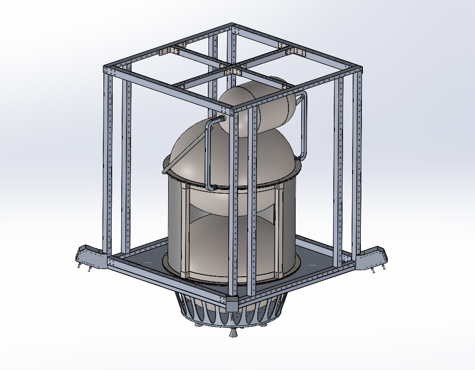
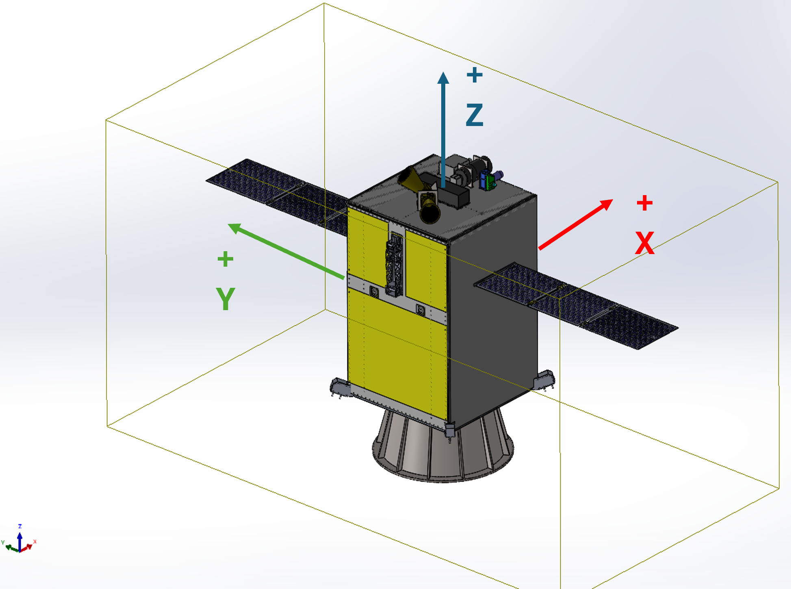
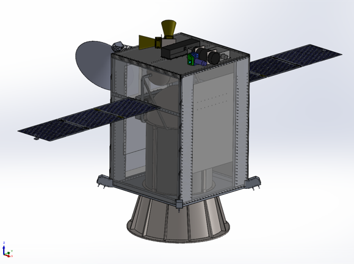
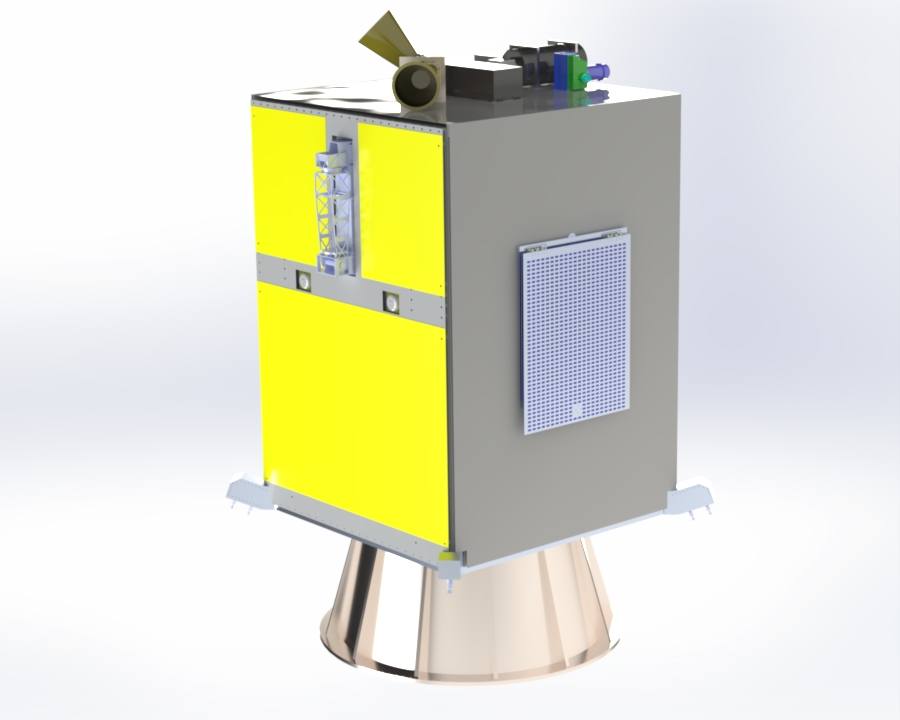

# Moonraker | Spacecraft Structural Design & Systems Integration

**Structures & Mechanisms (SAM) Lead | University of Colorado Boulder**  
**January – May 2026 | ASEN 5148: Spacecraft Design**

🏆 **Awarded Best Overall Mission Design**

  

  <em>Moonraker – Final Spacecraft Configuration (Click to enlarge)</em>

## Project Overview

Moonraker is a conceptual lunar orbiter spacecraft developed by a 14-member multidisciplinary engineering team at the University of Colorado Boulder.

As the **Structures & Mechanisms (SAM) Lead**, I led structural architecture development, mechanical design, subsystem integration, and preliminary structural validation through four major design iterations.

## Engineering Highlights

| Parameter | Result |
|---|---|
| Mission Design Award | Best Overall Mission Design |
| Spacecraft Mass | 1,760 kg |
| Structural & Mechanism Components | 100+ |
| Design Iterations | 4 |
| Axial Launch Load | 146.8 kN |
| Lateral Launch Load | 51.8 kN |
| Limit Margin of Safety | 2.40 |
| Ultimate Margin of Safety | 1.71 |
| Launch Vehicle | Falcon 9 |

---

## My Contributions

### Structural Design & Architecture

- Developed a **Falcon 9-compatible, 1,760 kg spacecraft architecture** by integrating 100+ structural and mechanism components while balancing mass, strength, CG constraints, and manufacturability.
- Achieved launch vehicle compatibility through **4 major design iterations** by refining structural layouts, subsystem packaging, and mechanical interfaces.
- Developed a hybrid Ti-Al structural architecture incorporating longerons, honeycomb panels, and subsystem mounting interfaces.

  

  <em>Moonraker – Structural Design & Architecture (Click to enlarge)</em>

### Structural Analysis & Validation

- Achieved **2.40 limit and 1.71 ultimate margins of safety** by performing Euler buckling calculations on Al 7075-T6 longerons.
- Evaluated structural survivability under **146.8 kN axial and 51.8 kN lateral loads** through preliminary structural sizing and load path calculations.
- Modeled load-bearing structural members in CATIA, evaluating stiffness, strength, and mass trade-offs.

  

  <em>Moonraker – Inner Structure (Click to enlarge)</em>

### CAD & Mechanical Design

- Developed integrated spacecraft assemblies using **SolidWorks and CATIA V5**.
- Designed payload decks, subsystem mounting interfaces, and deployable mechanism layouts.
- Improved assembly feasibility through modular layouts, bolted interfaces, and manufacturing considerations.

  

  <em>Moonraker – CAD & Mechanical Design (Click to enlarge)</em>

### Systems Integration

- Resolved structural interfaces and packaging constraints by coordinating with GNC, EPS, Thermal, Communications, Payload, Propulsion, and CDH teams.
- Advanced the spacecraft from system requirements through final layout verification.
- Managed subsystem placement, mass distribution, thermal clearances, and deployable mechanism integration.

  

  <em>Moonraker – Systems Integration (Click to enlarge)</em>

### Design Gallery

  A collection of structural components, mechanical assemblies, 
  and spacecraft configurations developed during the Moonraker project.

<table>
  <tr>
    <td align="center" width="50%">
      
       
      <b>Primary Structural Architecture</b>
    </td>
    <td align="center" width="50%">
      
       
      <b>Secondary Structural Architecture</b>
    </td>
  </tr>
  <tr>
    <td align="center">
      
       
      <b>Longeron Design</b>
    </td>
    <td align="center">
      
       
      <b>Honeycomb Panel Design</b>
    </td>
  </tr>
  <tr>
    <td align="center">
      
       
      <b>Payload Deck & Mounting Interfaces</b>
    </td>
    <td align="center">
      
       
      <b>Solar Array Integration</b>
    </td>
  </tr>
  <tr>
    <td align="center">
      
       
      <b>Subsystem Packaging</b>
    </td>
    <td align="center">
      
       
      <b>Exploded Spacecraft Assembly</b>
    </td>
  </tr>
  <tr>
    <td align="center">
      
       
      <b>Final Spacecraft Assembly</b>
    </td>
    <td align="center">
      
       
      <b>1:20 Scale Physical Prototype</b>
    </td>
  </tr>
</table>

  <em>Click any image to view the full-resolution design.</em>

---

## Spacecraft Specifications

| Parameter | Value |
|---|---|
| Team Size | 14 Members |
| Design Iterations | 4 Major Iterations |
| Spacecraft Height | 2.0 m |
| Approx. Bus Envelope | 1.5 m × 1.5 m × 2.0 m |
| Fairing Compatibility | Falcon 9 |
| Primary Structure Material | Ti-6Al-4V |
| Secondary Structure Material | Aluminum 7075 |
| Honeycomb Panel Thickness | 19.8 mm |
| Face Sheet Thickness | 0.8 mm |
| Longeron Length | 2050 mm |
| Longeron Configuration | 8 Structural Members |
| Structural Analysis Load Cases | Axial + Lateral |
| 3D Printed Scale Model | 1:20 Scale |

---

## Design Features

- Hybrid titanium-aluminum structural architecture
- Lightweight honeycomb panel construction
- Eight load-bearing structural longerons
- Modular subsystem mounting architecture
- Deployable solar array integration
- Optimized structural load paths
- Falcon 9 fairing-compatible configuration

---

## Design Development

The spacecraft underwent **four major configuration iterations** to resolve structural, packaging, and launch vehicle constraints.

Key development activities included:

- Structural architecture development
- Subsystem packaging and interface refinement
- Preliminary structural sizing and validation
- Final configuration and launch compatibility verification

  

  <em>Moonraker – Design Development (Click to enlarge)</em>

## Physical Prototype

Designed and fabricated a **1:20 scale 3D-printed spacecraft model** to visualize the final structural architecture, subsystem arrangement, and mission configuration.

  

  <em>Moonraker – 3D Printed Model (Click to enlarge)</em>

---

## Tools & Engineering Methods

| Category | Tools & Methods |
|---|---|
| CAD & Design | SolidWorks, CATIA V5 |
| Structural Analysis | Euler Buckling, Hand Calculations, Structural Sizing |
| Mechanical Design | GD&T, Engineering Drawings, Assembly Design |
| Systems Engineering | Interface Management, Mass Budgeting |
| Manufacturing | DFM/DFA, 3D Printing, Material Selection |
| Validation | Load Path Analysis, Margins of Safety, Design Reviews |

---

## Results & Recognition

### 🏆 Best Overall Mission Design

Moonraker was selected as the **Best Overall Mission Design** among competing spacecraft mission teams in the ASEN 5148 Spacecraft Design course at the University of Colorado Boulder.

### Key Outcomes

- Delivered a fully integrated Falcon 9-compatible spacecraft design.
- Achieved positive structural margins of safety under launch loads.
- Completed four major configuration iterations.
- Delivered complete Structures & Mechanisms subsystem documentation.
- Presented structural architecture during PDR and final design reviews.
- Fabricated a 1:20 scale spacecraft model.

  

  <em>Moonraker – Team Photo (Click to enlarge)</em>

---

## Contact
- LinkedIn: www.linkedin.com/in/anoopsubramanya
- Email: anoopms2001@gmail.com
